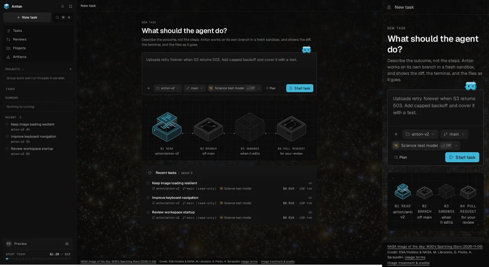

# Daily NASA science background

The shared content canvas shows NASA's latest **Image of the Day**, not APOD and
not an hourly feed. No API key or other credentials are required. The provider
fetches the official [IOTD RSS feed](https://www.nasa.gov/feeds/iotd-feed/) and
looks up the selected attachment's public WordPress metadata for the full credit.
NASA does not necessarily publish a new item every calendar day: the UI displays
the actual publication date, including on weekends.

## Cache and failure behavior

- `src/core/ports.ts`: `DailyScienceImageProvider` isolates the external service.
- `src/providers/nasa/daily-image.ts`: one process-local cached image (at most
  2 MiB) and one shared in-flight refresh. The first request on a UTC day refreshes
  the metadata; an unchanged published item reuses its existing bytes. There is
  no scheduled server polling, database change, disk archive or growing history.
- The provider requests a 960px NASA image-service rendition, not the full-size
  original. A 12-second total timeout, streamed byte limits (512 KiB RSS, 1 MiB
  metadata, 2 MiB image), MIME validation and disabled redirects bound downloads.
  All URLs are restricted to exact `https://www.nasa.gov` paths. The API is not
  an arbitrary URL proxy and callers cannot select a remote URL.
- `GET /api/science-background` returns metadata and a same-origin image URL;
  `GET /api/science-background/image?id=…` serves only the current content-hashed
  image. The browser may cache those bytes for a day.
- NASA errors, malformed data, unsupported media, unknown rights and oversized
  files retain the previous usable image. A cold cache returns `image: null`.
  A 30-minute provider failure cooldown prevents request storms. Refresh is
  request-driven, so this cooldown does not start background polling.
- The UI requests metadata at mount and each UTC midnight, never hourly. Hidden
  tabs suspend their timer; visibility/focus/pageshow resynchronize missed days
  without fetching again within the same day. On image load failure it swaps to
  the bundled fallback with the matching credit. On metadata failure it keeps the
  last image. Loading images remain invisible over the existing canvas, with no
  broken-image icon, retry loop or toast. Pending requests abort on unmount.
- Restarting the server clears its memory cache; the bundled fallback remains
  available offline. No guarantee is made that a new NASA publication appears
  immediately during the day; this deliberately uses a lightweight daily refresh.

## Rights and attribution

The footer on every route shows the displayed daily image's title, date, source
link, **full unaltered credit**, and usage-policy link. The static
[`credits.html`](../src/web/public/backgrounds/credits.html) page describes the
fallback, image treatment and non-endorsement notice.

NASA hosting alone is not permission. The provider fails closed on missing
credits, third-party/copyright/courtesy/restrictive-license notices, unknown
collaborations and captions indicating identifiable people. It accepts standard
NASA-owned credits under [NASA's media guidelines](https://www.nasa.gov/nasa-brand-center/images-and-media/),
known NASA/ESA/CSA/STScI imagery under the [STScI policy](https://webbtelescope.org/copyright),
and joint ESA/Hubble & NASA imagery under the [ESA/Hubble CC BY 4.0 policy](https://esahubble.org/copyright/).
NASA metadata explicitly declaring copyright is also rejected. This conservative
credit/caption gate is not a universal license parser: new credit formats require
review and tests before being accepted. No NASA endorsement is implied.

The fallback is `src/web/assets/science/black-hole.webp` (about 18 KiB), a static
first frame of NASA's [black-hole accretion-disk visualization](https://www.nasa.gov/feature/goddard/2019/nasa-visualization-shows-a-black-hole-s-warped-world/).
Credit: **NASA’s Goddard Space Flight Center/Jeremy Schnittman**. Original:
[stationary GIF](https://www.nasa.gov/wp-content/uploads/2019/09/bh_accretiondisk_sim_stationary_websize.gif).
It is a scientific simulation, not a telescope photograph. Only frame 0 is used:

```sh
convert 'source.gif[0]' -strip -resize '960x540^' -gravity center -extent 960x540 \
  -resize 480x270 -ordered-dither o8x8,24 -filter point -resize 960x540 \
  -quality 77 black-hole.webp
```

## Appearance and performance

One decorative image node sits behind the isolated main canvas. The daily photo
is cropped to cover, shown at 28% opacity before a dark scrim/vignette, and covered
by a static 3px pixel mesh. The fallback additionally has baked ordered dithering.
Existing typography, sidebar, cards, controls, menus and panels retain their
surfaces. The source-credit footer is opaque and keyboard accessible.
There is no animation, blur, canvas, WebGL, blend mode or GPU promotion. Forced
colors and print hide the decorative layer. No new package dependencies are added.

## Verification

- `node --experimental-strip-types --test tests/nasa-daily-image.test.ts`: feed,
  metadata, cache/day rollover/concurrency, rights, bounds, timeout and API tests.
- `npm run test:ui -- tests/ui/science-background.test.tsx`: daily refresh, resume,
  credits, image/metadata fallback, accessibility attributes and cleanup.
- `npm run check:types`, `npm test`, `npm run test:ui`, `npm run build`.
- Browser checks via the exact Preview URL: real daily image from NASA through
  the server cache, desktop and 320px/390px layouts, editable controls, source
  credits, one-image requests, midnight rollover using a clock and controlled
  next-day metadata, hourly non-rotation, forced colors and image failure.

## Visual record



The screenshot uses fixture task data, but the real NASA daily image fetched
through the server: **M30’s Sparkling Stars**, published 2026-11-06.
Credit: **ESA/Hubble & NASA, M. Libralato, G. Piotto, A. Sarajedini**.
[Source](https://www.nasa.gov/image-detail/hubble-m30-potm2610a/) ·
[ESA/Hubble usage policy](https://esahubble.org/copyright/) ·
[CC BY 4.0](https://creativecommons.org/licenses/by/4.0/).
Image adaptations in the screenshot: resizing, cropping, low opacity, dark scrim
and pixel mesh. No endorsement is implied. This is a fixed review record, not a
bundled daily image; only the small black-hole fallback ships as an app asset.
